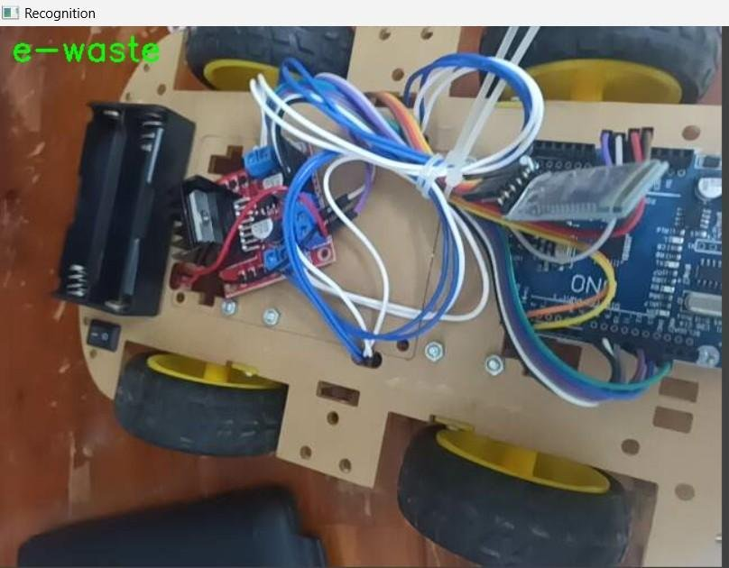
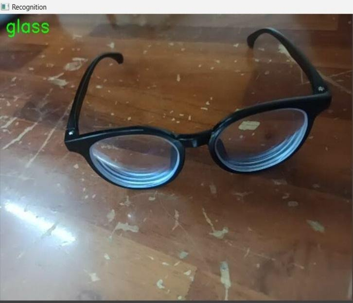
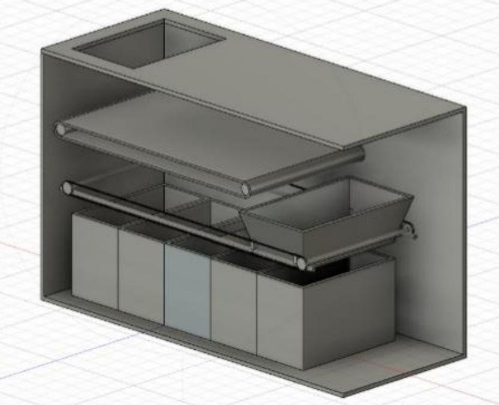
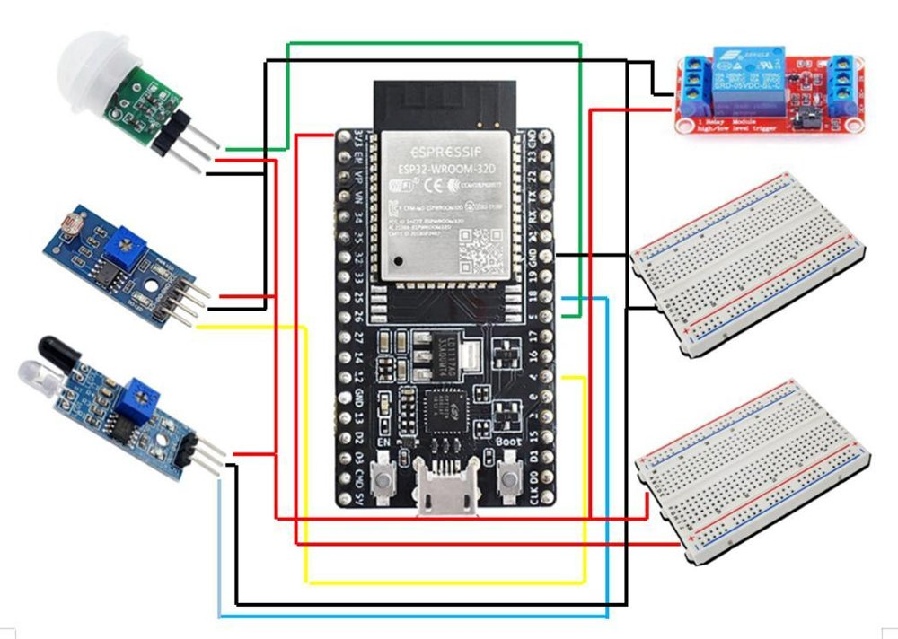

# AI Waste Sorting (KHKT 2023)

A camera-based waste classifier that sorts items into **7 classes**
(cardboard, e-waste, glass, medical, metal, paper, plastic) using a VGG16
network fine-tuned with PyTorch. Built as a high-school science and
engineering fair project (Robotics and Intelligent Machines category,
Nguyen Quang Dieu High School for the Gifted, Dong Thap, November 2023).

The webcam script labels each frame in real time; the intended hardware
routes the item to the matching bin once the same label holds for 5 seconds.

| Live recognition: e-waste | Live recognition: glasses → glass |
| --- | --- |
|  |  |

## System



1. A motion sensor detects an item placed on the intake; a light sensor
   switches on a lamp when it is too dark for the camera.
2. The camera frame goes through the classifier (`Run.py`).
3. An ESP32 drives relays: conveyor 1 carries the item in, conveyor 2 moves
   it over the bin for its class, and the item drops in.



The full design, flowcharts and test photos are in the report PDF.

## Files

| File | What it is |
| --- | --- |
| `trainmini.ipynb` | Training and evaluation (Google Colab): ImageNet-pretrained VGG16, last layer replaced by a 7-way classifier, Adam (lr 1e-5), 10 epochs, 224×224 inputs |
| `bieudo.ipynb` | Charts: per-class precision, recall and F1 |
| `Run.py` | Real-time webcam inference with OpenCV |
| `modelmodel7classvgg16.h5` | Trained weights (PyTorch `state_dict`, stored with Git LFS) |
| `Mô hình phân loại rác tích hợp công nghệ AI KTAM.pdf` | Full project report (Vietnamese, 33 pages) |
| `Lưu đồ mô hình.drawio`, `Lưu đồ thuật toán.drawio` | System and algorithm flowcharts (open with diagrams.net) |

## Run

```bash
git lfs install && git lfs pull        # fetch the model weights
pip install -r requirements.txt
python Run.py                          # press q to quit
```

## Results

The notebook reports 97.9% accuracy (macro F1 0.98) on 1,793 images.

| Class | Precision | Recall | F1 |
| --- | --- | --- | --- |
| cardboard | 1.00 | 0.96 | 0.98 |
| e-waste | 0.98 | 1.00 | 0.99 |
| glass | 0.96 | 1.00 | 0.98 |
| medical | 0.98 | 0.97 | 0.97 |
| metal | 0.98 | 0.99 | 0.99 |
| paper | 0.99 | 0.96 | 0.98 |
| plastic | 0.97 | 0.97 | 0.97 |

**Known issue:** in `trainmini.ipynb` the training set is loaded from the
`test` folder, the same folder used for evaluation, so the figures above are
measured on images the model was trained on and overstate real-world
accuracy. Retraining on the `train` split and evaluating on `test` (or
`valid`) gives the honest number; that fix is the next step for this repo.

## Possible improvements

- Fix the split above and add a confusion matrix on held-out data.
- Swap VGG16 (528 MB of ImageNet weights, slow on CPU) for MobileNetV3 or
  EfficientNet-B0 to run on a Raspberry Pi.
- Add data augmentation and real photos from the bin's own camera, since
  lighting and backgrounds differ from web images.
